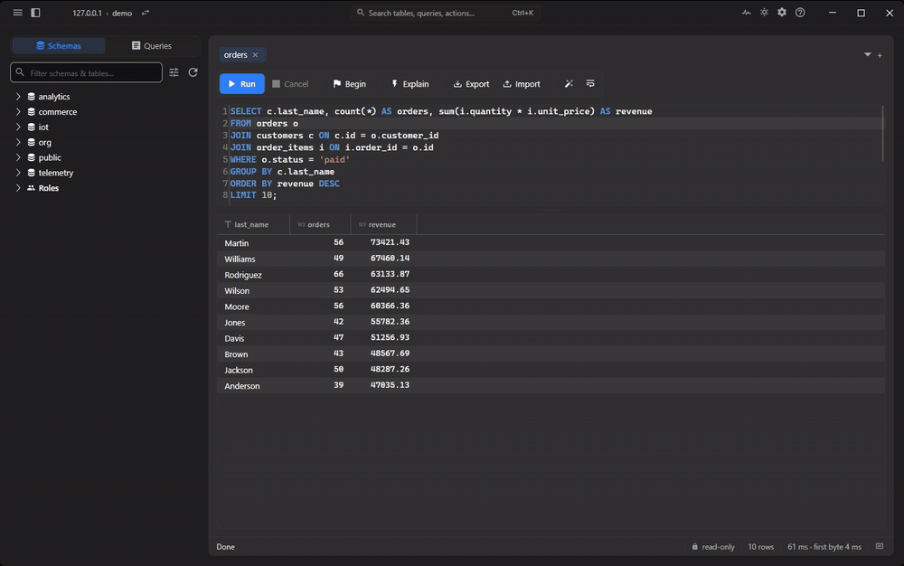
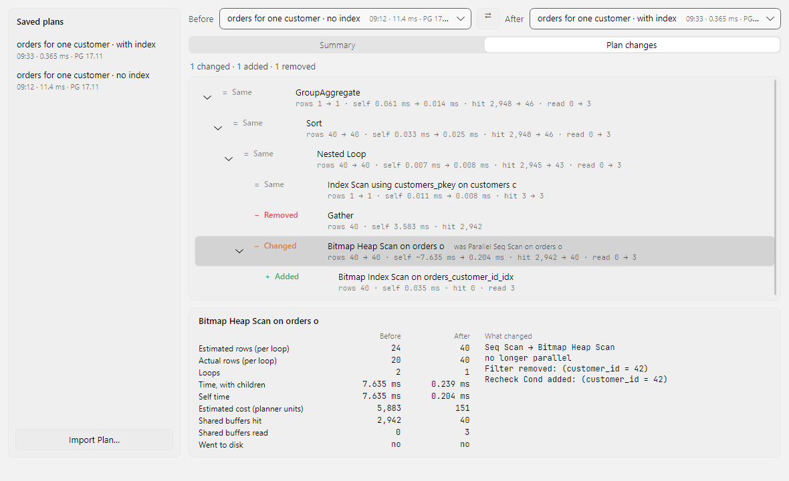

# Query plans

pgNimbus does not dump `EXPLAIN` output at you. It parses the plan, walks it for
known problems, and draws it as a tree with a time heat map.

## Running EXPLAIN

| Action | Shortcut |
| --- | --- |
| Explain, the estimated plan, does not run the query | <kbd>Ctrl</kbd>+<kbd>E</kbd> |
| Explain Analyze, which actually runs the query | <kbd>Ctrl</kbd>+<kbd>Shift</kbd>+<kbd>E</kbd> |

Both are also on the toolbar's Explain button and in the command palette.

!!! info "Analyzing a write is safe"

    `EXPLAIN ANALYZE` really executes the statement, which normally makes it
    dangerous on an `INSERT`, `UPDATE`, `DELETE`, `MERGE`, or a data-modifying
    CTE. pgNimbus runs every analyze inside a transaction it then rolls back, so
    nothing persists. When the statement was data-modifying, the warnings strip
    says so explicitly rather than leaving you to trust it.

Explain takes one statement. With nothing selected it explains the statement
the caret sits in. A selection that holds several statements is refused, and
the status line says so, because the server would run every statement in it
while planning only the first. Select a single statement and try again.

The analyze path always requests `BUFFERS` and `SETTINGS`. Buffer counts are what
the spill and lossy-bitmap analysis reads, and they are the most useful thing
missing from a bare plan.

## The tree

Each node's bar is sized by its exclusive self time, the time spent in that node
without counting its children, so the bar lengths point at where the query
actually spent itself rather than at whatever sits near the root. The single
slowest node is tinted as the bottleneck. Without `ANALYZE` timings the bars fall
back to cost.

Re-colour by metric. The header has a segmented Colour toggle, offering Time,
Rows, Cost and Buffers, that rescales the bars in place and re-marks the hottest
node. Switching to Buffers is how you find the node doing the I/O when the slow
one is merely waiting on it.

There is a Text view alongside the tree, formatted the way
`EXPLAIN (FORMAT TEXT)` would: per-pool block counters folded onto one `Buffers:`
line, an `I/O Timings:` line, and zero-valued counters dropped so the output stays
readable.

## Warnings

Above the plan sits a strip of plain-language warnings, each with something
actionable to do about it:

- row estimates that are badly wrong, the usual root cause of a bad plan choice
- sorts and hashes that spilled to disk, often a `work_mem` conversation
- sequential scans that are doing more work than they should
- lossy bitmap heap blocks, meaning the bitmap outgrew `work_mem` and Postgres
  fell back to re-checking whole pages

Each check uses a conservative threshold, so the strip stays quiet on healthy
plans and means something when it is not.

## Pasting a plan from somewhere else

"Import query plan…" in the command palette takes a plan from your clipboard,
with no database round-trip and no connection needed to the server it came from.
It opens in a new tab with the same tree, heat map and warnings as a live plan.

It auto-detects the format and is tolerant of what other tools emit. For
`FORMAT JSON` that means the `[{ "Plan": … }]` array, a lone `{ "Plan": … }`
object, or a bare `{ "Node Type": … }` node. `FORMAT TEXT` is parsed best-effort,
and `psql`'s framing is stripped for you.

This is the way to look at a plan a colleague pasted into a ticket, or one pulled
off a production server you cannot reach from your laptop.

## Sharing a plan back out

The plan header's Export menu copies or saves the plan as JSON or as rendered
text. The JSON is the raw server output, so it round-trips into any other plan
tool. A plan you imported from text has no JSON to export, so those actions are
hidden.

## Comparing plans in Query Lab

Query Lab keeps the plans you want to come back to and compares any two of them.
It saves each one on this computer under a name, along with what pgNimbus knows
about how it was measured: the statement, the server version, the connection and
the time.

It starts from the plan header's Compare menu. "Save to Query Lab…" keeps the plan
on screen, and saving it again under the same name updates it. "Compare With"
lists your most recent saved plans: pick one, and Query Lab opens with it as the
before side and the plan on screen as the after side, which doesn't need saving
first. "Open Query Lab" just opens the window, as the command palette does.

A typical round goes like this: run Explain Analyze, save the plan, create an
index, run Explain Analyze again, then choose Compare With and the saved plan.

Query Lab needs no connection. "Import Plan…" under its list adds a pasted plan,
JSON or text, so two plans from a ticket or from another machine compare just as
well. Double-click a saved plan to open it in a new tab. Right-click it to rename
it, delete it, or put it on one side of the comparison.

### The summary

The Summary tab sets the two plans' figures side by side: execution and planning
time, rows returned and estimated, the planner's estimated cost, and the buffers
each run read. A dash means that plan doesn't have the figure, and hovering over
it says why ("not analyzed" for a plain EXPLAIN, for example). The change column
gives the difference and nothing else. It never calls a run faster or better,
because two single runs can't show that.

Under the figures, notes say what the two runs can't show. "One run each" is
there whenever both plans were analyzed: timings move from run to run, so run each
side a few times before you read much into a difference. "The cache may explain
part of the difference" appears when one run read many blocks from outside shared
buffers and the other read almost none, since a run that finds its data in memory
spends less time whatever its plan. "Estimates only" means a plan wasn't analyzed
and has no actual time, rows or buffers; its estimated cost is in planner units,
not time. Different PostgreSQL versions, planner cost settings, parallel workers,
JIT, connections, statements and row counts each get a note of their own.

Planner settings that differ (from `EXPLAIN (SETTINGS)`) are listed too, along
with the plan warnings that went away or are new.

### Plan changes

The Plan changes tab merges the two plans into one tree, laid out like the after
plan, and marks each node Same, Changed, Added or Removed. A changed node also
says what it was before ("was Parallel Seq Scan on orders o").
Select a node to see its figures on both sides and what it does differently: the
scan type, the index, a filter that became an index condition.

pgNimbus pairs nodes by the tables they read, so a scan that changed type is one
changed node rather than one removed and one added. A join whose inputs swapped
sides is marked as such, and a long run of partition scans that pruning added or
removed folds into one row.

Saved plans live in the `query-lab` folder of pgNimbus's app data, one file per
plan. Query Lab keeps up to 200 and refuses a save past that rather than drop
one.

## Next

[Monitor the server](monitoring.md)
